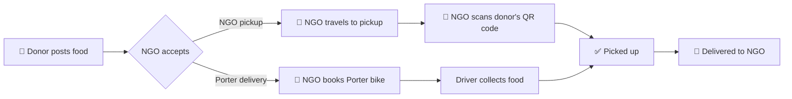

<div align="center">

# 🍽️ Serve-N-Help

**Rescue surplus food. Feed people, not landfills.**

An Android app that connects restaurants, caterers and households that have extra food with NGOs that can get it to people in need, before it expires.


</div>

---

## 🌍 The problem

Every day restaurants, hotels, caterers and homes throw away food that is still good to eat, while people nearby go hungry. Donors and NGOs usually have no simple way to find each other in time, and no way to prove the food actually changed hands.

**Serve-N-Help** gives both sides one place to list food, claim it, pick it up and track it until it's delivered.

---

## ✨ What the app does today

| | Feature | Details |
|---|---|---|
| 🔐 | **Sign-in** | Email & password, **Google sign-in**, and **biometric (fingerprint / face) login** for returning users. Separate **Donor** and **NGO** roles. |
| 🍛 | **Post a donation** | Food name, category, quantity, expiry time and an exact pickup point chosen on a map. |
| 🗺️ | **Find food nearby** | NGOs browse a filterable feed (cooked meals, bakery, raw produce, packaged) or a live map of every available donation. |
| 📦 | **Donation lifecycle** | `Available → Accepted → Picked up → Delivered`, with a timeline showing who did what and when. |
| 🔳 | **QR pickup verification** | The donor shows a one-time QR code; the NGO scans it with the camera to confirm the handover. A wrong or reused code is rejected by the server. |
| 🛵 | **Porter delivery** *(sandbox)* | Donors can choose *"Send it with Porter"*. The NGO gets a fare quote, books a bike, and follows the driver live on a map. Status updates automatically. |
| 📊 | **Dashboard & profile** | Kg rescued, live and delivered counts, past donations, editable account details. |
| 🌗 | **Light & dark theme** | Follow the phone, or force light / dark from the profile screen. |

---

## 🔄 How a donation flows



---

## 🔳 QR pickup verification

Without proof, anyone could mark food as "picked up". Our handover check works like this:

1. When the donor opens **Show pickup code**, the app makes a random 8-character code.
2. The plain code is stored where **only the donor** can read it. The donation itself only stores its **SHA-256 hash**.
3. The NGO scans the QR (built with **CameraX + ML Kit**), or types the code by hand.
4. **Firestore security rules** hash what the NGO sent and compare it with the stored hash. Only a match can move the donation to *Picked up*, so the check can't be skipped by a modified app.

---

## 🛵 Porter integration

[Porter](https://porter.in) is an Indian on-demand delivery service. Their partner API needs business approval, which takes time, so the app currently talks to a **sandbox** that behaves like Porter's real API:

- **Same contract as the real API**: `getQuote`, `createOrder`, `trackOrder`, `cancelOrder` (see [`Porter.java`](app/src/main/java/com/example/serve_n_help/Porter.java)).
- **Realistic trips**: driver assignment, pickup, drop, fare based on distance, and a moving bike on the map. Trips run at demo speed (about 3 minutes).
- **Drop-in replacement**: once API access is approved, only [`PorterSandbox.java`](app/src/main/java/com/example/serve_n_help/PorterSandbox.java) is swapped for the real client.

---

## 🛠 Tech stack

| Layer | Tools |
|---|---|
| **App** | Java 11, XML layouts, Material Components, Android Studio |
| **Backend** | Firebase Authentication, Cloud Firestore, Firestore Security Rules |
| **Sign-in** | Credential Manager (Google), AndroidX Biometric |
| **Maps & location** | Google Maps SDK, Play Services Location |
| **QR codes** | CameraX (camera preview), ML Kit Barcode Scanning (reading), ZXing (generating) |
| **Delivery** | Porter API contract, served by an in-app sandbox for now |

---

## 📂 Project structure

```
app/src/main/java/com/example/serve_n_help/
├── LoginActivity, CreateAccountActivity      # sign-in, Google, biometrics
├── RestaurantDashboardActivity               # donor home + stats
├── FoodAvailableActivity, DonationsMapActivity  # NGO feed and map
├── AddFoodActivity, LocationPickerActivity   # post a donation
├── DonationDetailsActivity                   # timeline, accept, pickup, deliver
├── Handover, HandoverScanActivity            # QR code generation and scanning
├── Porter, PorterSandbox, PorterCard,
│   PorterTrackingActivity                    # Porter delivery + live tracking
├── ProfileActivity, ThemePrefs               # account and appearance
└── Donation, FirebaseRepo, Ui, BaseActivity  # model and shared helpers
```

### Firestore collections

| Collection | Holds |
|---|---|
| `users` | Name, email, phone, role (donor / NGO) |
| `donations` | Food details, pickup location, expiry, status, NGO, QR code hash, Porter order |
| `donations/{id}/private` | The plain pickup code, readable by the donor only |
| `pickupRequests` | Which NGO claimed which donation, and its status |
| `porterSim` | Sandbox Porter orders |

---

## ⚙️ Setup

1. Create a Firebase project and add an Android app with package name `com.example.serve_n_help`.
2. Download `google-services.json` and place it in `app/`.
3. In the Firebase console:
   - enable **Authentication → Email/Password** and **Google**;
   - create a **Cloud Firestore** database;
   - paste the contents of [`firestore.rules`](firestore.rules) into the **Rules** tab and click **Publish**.
4. In the Google Cloud console, enable **Maps SDK for Android** for the same project and create an API key.
5. Add the key to `local.properties` (this file is not committed):
   ```
   MAPS_API_KEY=your_key_here
   ```
6. Sync Gradle and run on a device with Android 7.0 (API 24) or newer. A real phone is best for QR scanning and biometrics.

---

## 🗺️ Progress & roadmap

**Done**
- [x] Email, Google and biometric sign-in with donor / NGO roles
- [x] Post donations with map-picked pickup location and expiry
- [x] NGO feed with category filters and a live donations map
- [x] Full donation lifecycle with timeline
- [x] QR code pickup verification, enforced by Firestore rules
- [x] Porter delivery with fare quotes and live tracking (sandbox)
- [x] Dashboard stats, profile, light / dark theme

**Next**
- [ ] Connect the real Porter API once access is approved
- [ ] Push notifications (Firebase Cloud Messaging) for new donations and status changes
- [ ] Food photos (Firebase Storage)
- [ ] Volunteer role for people who deliver on foot or by bike
- [ ] In-app chat between donors and NGOs
- [ ] Impact analytics and multilingual support

---

## 🎯 Who it's for

Restaurants · Hotels · Caterers · Event organisers · Supermarkets · Households · NGOs

---

## 👨‍💻 Contributors

Developed by our team as a Mobile Application Development project.

## 📄 License

Released under the [MIT License](LICENSE). Built for educational purposes.
